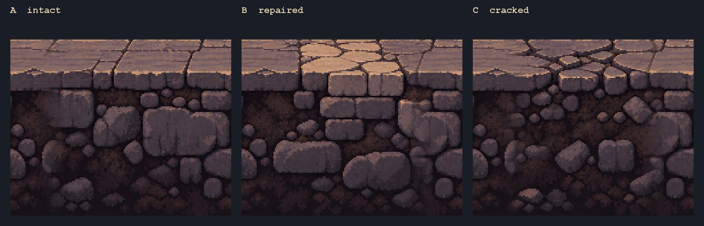
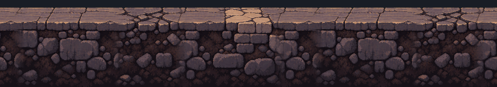

# Пример составной дороги для руин

Эти три модуля подключены к начальным улицам и руинам. Они показывают, как
сохранить крупную перспективную кладку и переставлять большие фрагменты дороги.





## Что лежит в папке

| Файл | Назначение |
| --- | --- |
| `source-red-road.png` | Нарисованная цельная полоса, источник материала и палитры. |
| `road-A.png` | Обычная целая кладка. |
| `road-B.png` | Светлая ремонтная вставка. |
| `road-C.png` | Треснувший участок. |
| `module-sheet.png` | Три варианта по отдельности. |
| `assembled-A-C-B-A-C.png` | Пример новой последовательности из тех же вариантов. |
| `RoadModuleExample.java` | Воспроизводимая нарезка, договорённость о краях и проверка стыков. |
| `soil-reference-portrait.png` | Нарисованный образец земли для нижней части игровых модулей. |
| `RoadDepthComposer.java` | Сборка игровых текстур 512 × 1024 без растяжения рисунка. |

Каждый исходный модуль имеет размер **512 × 448 пикселей**. Игровые текстуры
дорисованы до **512 × 1024 пикселей**. Один модуль занимает **2 мировые единицы
в ширину**, то есть две физические клетки 1 × 1. Высота рисунка — 4 мировые
единицы. Одинаковое отношение пикселей к мировым единицам по обеим осям
сохраняет пропорции камней. Верх видимого мощения расположен на 0,18 мировой
единицы выше линии коллизии, поэтому ноги героя оказываются внутри рисунка.

## Почему соединение работает

У всех модулей одна высота поверхности, направление света и масштаб камней.
Первые 64 пикселя каждого модуля берутся из одной правой стороны эталонного
стыка, последние 64 — из его левой стороны. Эти две стороны были соседями в
исходной непрерывной полосе. Поэтому сочетания A→B, C→A и любые другие имеют
одинаковый профиль соединения. Между общей кромкой и уникальной серединой есть
переходная область. `RoadModuleExample.java` проверяет контракт пиксель в пиксель.

В финальных текстурах художник должен вручную доработать переходную область:
алгоритмическое смешивание здесь служит демонстрацией, а не заменяет чистый
пиксельный рисунок. При постоянном повторении одного типа шва он тоже станет
заметен; следующему набору нужны несколько совместимых типов краёв.

## Как это используется в игре

Копии модулей находятся в `assets/terrain/ruins-road-A.png` и соседних файлах.
`RoadSurfaceRenderer` выбирает вариант по seed локации и мировой координате,
привязывает рисунок к линии физического пола и рисует дорогу за персонажами.
Игровые версии трёх модулей продлены вниз до 1024 пикселей. Для подземной части
использован нарисованный образец `soil-reference-portrait.png`; переход к нему
плавно встроен в исходные модули скриптом `RoadDepthComposer.java`. Исходные
модули 512 × 448 в этой папке сохранены для повторной сборки. Зеркальное
повторение нижней строки в рендерере удалено. При сборке глубины пиксели
образца по горизонтали и вертикали уменьшаются с одинаковым коэффициентом,
поэтому нижние камни не вытягиваются.
Коллизии по-прежнему задают обычные клетки 1 × 1. Сейчас набор покрывает
ровный нижний пол начальных улиц и руин; платформы, ступени и обрывы сохраняют
прежний рисунок до появления специальных переходных модулей.

## Как расширять набор

1. Генератор сначала строит физическую дорогу на сетке 1 × 1 и находит
   непрерывные горизонтальные отрезки с ровной верхней поверхностью.
2. Отрезок делится на интервалы длиной 2 клетки. Для каждого интервала по seed
   выбирается A, B или C. Повтор A–A–A лучше ограничить правилом разнообразия.
3. Художественные модули рисуются **поверх базовых тайлов земли, но позади
   героя, предметов и NPC**. Базовые тайлы в перекрытой зоне остаются коллизией,
   а их обычный рисунок не должен проступать сквозь модуль.
4. Модуль привязывается к *линии ходьбы*, а не к нижней границе комнаты.
   Видимая поверхность начинается на 0,18 мировой единицы выше физических
   блоков. Смещение от верхнего края PNG зафиксировано в рендерере.
5. Конец отрезка, обрыв, ступень, лестница и сломанная кромка требуют отдельных
   переходных модулей. Этот пример покрывает только прямую ровную дорогу.
6. Мелкие следы жизни — пыль, лужи, обломки, следы телег — рисуются отдельным
   слоем поверх дороги. Они не меняют коллизию и распределяются реже, чем сами
   модули.

Ближайший производственный набор: 8–12 вариантов прямой кладки, 2–3 типа
совместимых швов, левый/правый торец, обрыв, ступень вверх/вниз и отдельные
узлы для Красной, Ковена и Механической Конгрегации. Сюжетные здания остаются
авторскими; модули собирают дорогу между ними.

Для пересборки примера из исходной полосы на JDK 17:

```powershell
& 'C:\Program Files\Java\jdk-17\bin\java.exe' `
  'documents\road-texture-examples\RoadModuleExample.java' `
  'documents\road-texture-examples'
```

После изменения исходных модулей пересобрать игровые текстуры 512 × 1024:

```powershell
& 'C:\Program Files\Java\jdk-17\bin\java.exe' `
  'documents\road-texture-examples\RoadDepthComposer.java'
```
